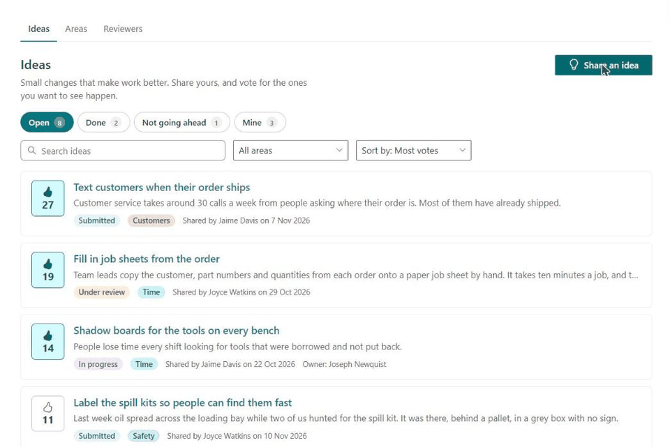
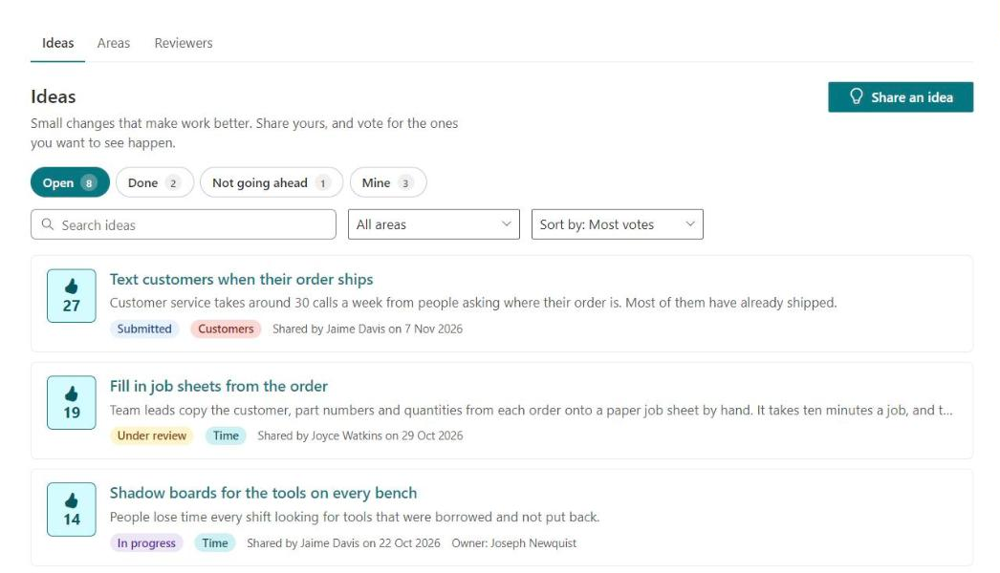
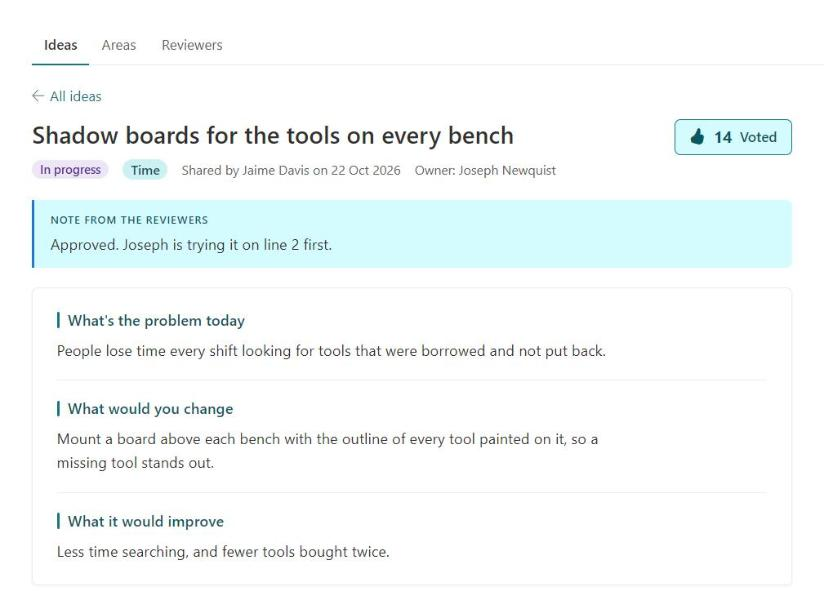
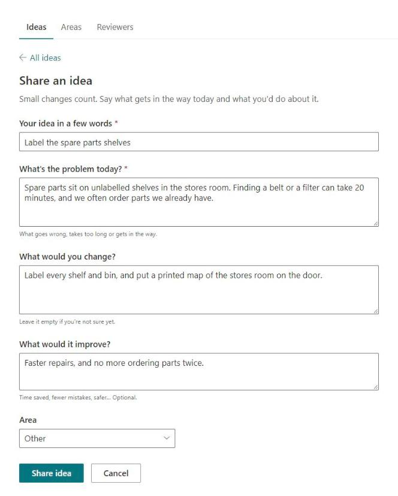
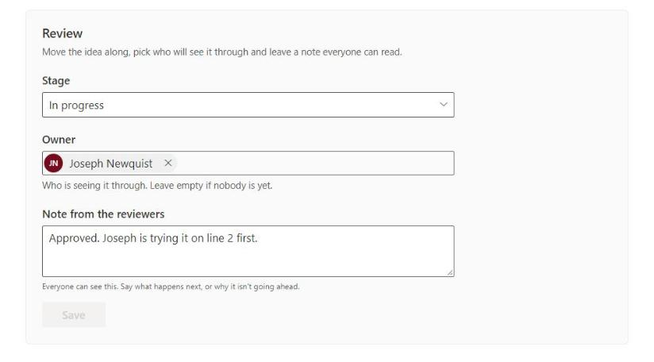
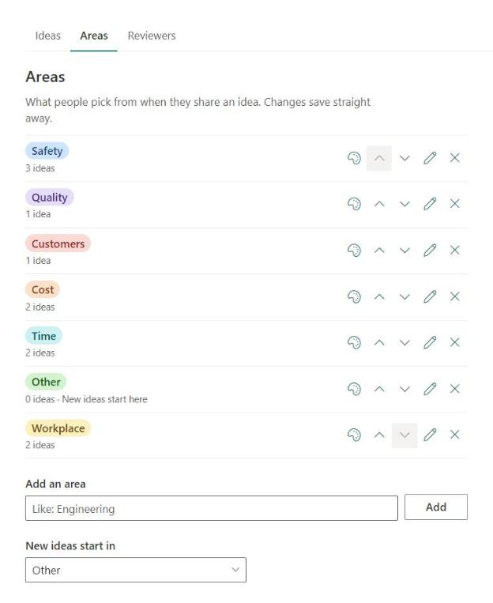

# Kaizen Ideas

A SharePoint web part for continuous improvement: staff share ideas for making work
better, vote for the ones they want to see happen, and follow each one through to done.
Everything is kept in SharePoint lists on the site. No server, no email.



For a tour of the features, see the [Kaizen Ideas page](https://thomasdaly.net/projects/kaizen-ideas/).

## What you need

| Who | What they do |
|---|---|
| SharePoint Administrator | Uploads the package to the tenant app catalog and enables it. |
| Site owner | Adds the app and web part to a page, runs setup and picks the reviewers. |
| Site collection administrator | Only needed when the page says something needs IT. |

It uses SharePoint only. There are no API permissions to approve, and it sends no email,
so you'll need to tell people where to find the page.

## Install

1. Download `react-kaizen-ideas.sppkg` from the
   [latest release](https://github.com/tom-daly/react-kaizen-ideas/releases/latest).
2. In the **SharePoint admin center**, go to **More features → Apps → Open**, then
   **Upload** the file.
3. In the panel that opens, choose whether to tick **Enable this app and add it to all
   sites**, then click **Enable app**. If you leave it unticked, site owners add it from
   **New → App** on their own site, under **From Your Organization**.
4. On a site all staff can open, edit a page and add the **Kaizen ideas** web part, which
   is in the web part picker's **Advanced** group. Publish the page.
5. A site owner opens the page and clicks **Set up Kaizen ideas**. That makes two lists
   and a group:

| List | Web address | Who sees what |
|---|---|---|
| Kaizen ideas | `Lists/KaizenIdeas` | Everyone sees every idea and can share their own. Each person can change only their own. Reviewers and site owners can change any. |
| Kaizen votes | `Lists/KaizenVotes` | One row per vote. Everyone can vote and take back only their own vote. Hidden, kept out of search, no version history. |

The **Kaizen Reviewers** group is owned by the site's Owners group. Site owners add and
remove reviewers on the **Reviewers** page of the web part.

Setup is safe to run again. When something is missing or has been changed by hand,
site owners see a **Fix it** button on the page.

Removing the web part never deletes the lists or the ideas in them.

## Who sees what on the page

- **Everyone** gets the board: every idea, with pills for Open, Done, Not going ahead and
  Mine, a search box, an area picker and a sort (most votes or newest). They can share an
  idea, vote, and take a vote back while an idea is still open.
- **The person who shared an idea** can change or delete it until a reviewer moves it on
  from Submitted. A deleted idea goes to the site's recycle bin.
- **Reviewers** also get a Review panel on each idea: its stage, who owns it, and a note
  everyone can read. They can change the areas on the Areas page, and see the Reviewers
  page but not change it.
- **Site owners** can do all of that, run setup, and add or remove reviewers.

Stages: Submitted, Under review, In progress, Done, Not going ahead.

The areas (Safety, Quality, Cost, Time, Customers, Workplace, Other) are only a starting
point. Reviewers and site owners change them on the **Areas** page: add one, rename one,
take one off, put them in order, give each a pill colour and pick the one new ideas start in. Each change saves
straight away. Renaming an area moves its ideas with it. Taking one off leaves its ideas
where they are, and the board's area picker keeps it while any idea still has it. The page
saves to the **Area** column of the Kaizen ideas list, so changing that column by hand
works too. Setup never puts the old areas back.

### What it looks like

**Ideas**







**Review**



**Areas**



## Known limits

- Anyone can change their own idea's **stage** by editing the list directly in SharePoint,
  because SharePoint lets people change every column of a row they added. The page itself
  only lets reviewers change it.
- "Reviewer" means anyone who can manage the ideas list. On a site where staff are
  **members** with Edit rights, they get that from the site and count as reviewers too.
  Put the web part on a site where staff are visitors, such as a communication site.

## Development

Node 22.14.0, as set in `.nvmrc` (`nvs use` picks it up). `build.cmd` does the whole
build in one go: it switches to that Node version through nvs for the build only, installs
packages if they aren't there yet, then builds and packages.

Or by hand, after `npm install`:

- `npm run build`: build, lint, test and package (`sharepoint/solution/*.sppkg`).
- `npm start`: serve locally for the hosted workbench.
- `npx heft test`: run the tests.

SharePoint calls go through [PnPjs](https://pnp.github.io/pnpjs/). The list definitions
live in `src/webparts/kaizenIdeas/setup/schema.ts`. All the words people see are in
`src/webparts/kaizenIdeas/strings/`.

### Publishing a release

Push a version tag and GitHub builds, tests and publishes the release, with the `.sppkg`
attached:

```bash
git tag v1.0.0
git push origin v1.0.0
```

The tag sets the package's version, so use a higher number each time. SharePoint uses it
to tell that the package has been updated.

## Licence

[MIT](LICENSE) © TMD Consulting LLC.
